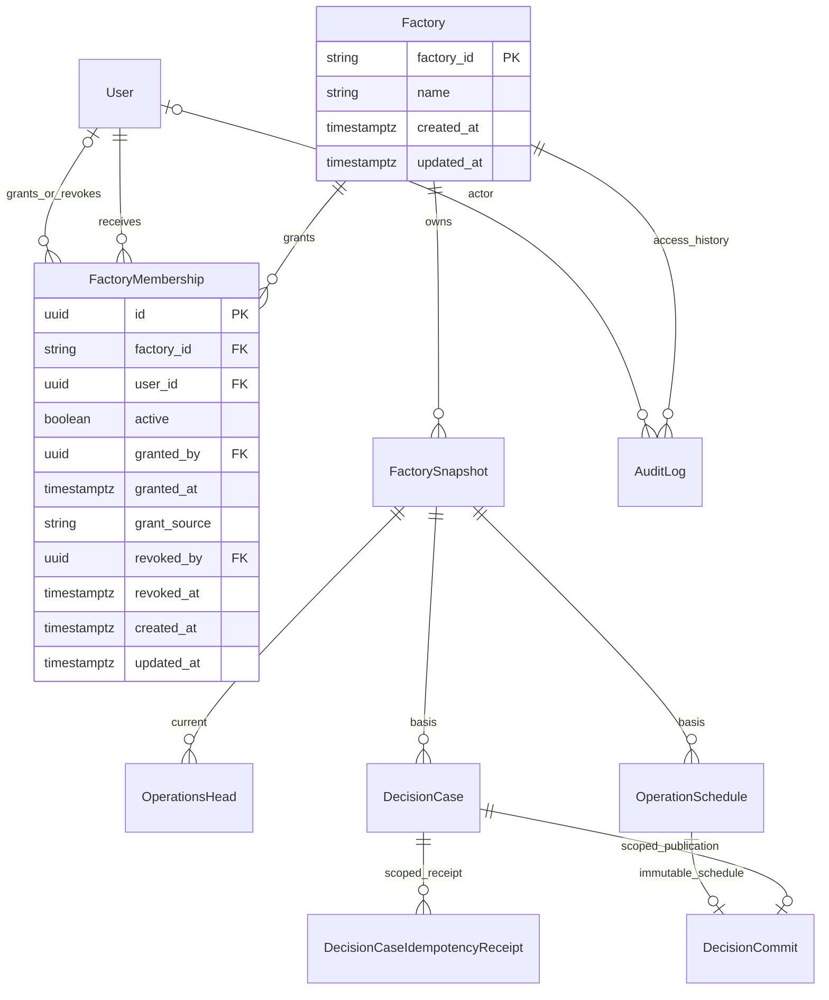

# Factory registry and access management

Base: main `4c7aae108942a363a4dc4ee40f4ccb81bdfd8a53`, which includes reviewed
Overview #45 (`9404ecb`). Independent branch `feat/factory-access-management`.
Contract-first draft; no automatic merge. Python domain schema 3.0 is unchanged.
HTTP authority: backend/openapi.yaml. Examples: examples/factory-access.json.

## ERD and integrity



Unique membership (factory_id,user_id); stable ID across revoke/regrant. Active
means revoked_by/at are null; revoked means both are present and revoked_at >=
granted_at. HTTP grant source=http requires granted_by; system import source has
run ID and null actor. Timestamps are server/database-owned, ordered. No factory
roles or JSON permissions. User/grant/revoke FKs RESTRICT, never CASCADE.
AuditLog SYSTEM events carry factory_id FK, target_user_id, before/after, source,
run ID and actor/time. Existing AuditLog is the single journal. Access events are
append-only at DB level, not editable/deletable through this API. Import summary
is a SYSTEM audit with source/run/counts. Membership is latest state; audit keeps
all prior grant/revoke transitions. No hard-delete factory API.

| Existing factory scope | Integrity path after migration |
| --- | --- |
| FactorySnapshot | Direct factory_id FK -> Factory |
| OperationsHead | Existing (factory_id,snapshot_id) -> snapshot; schedule composite FK |
| OperationSchedule | Existing (factory_id,snapshot_id) -> immutable basis snapshot |
| DecisionCase | Existing (factory_id,snapshot_id) -> snapshot; new unique(id,factory_id) |
| DecisionCommit | Existing scoped schedule FK plus (case_id,factory_id) -> case (replaces unscoped case FK) |
| DecisionCaseIdempotencyReceipt | (case_id,factory_id) -> case (replaces unscoped case FK) |
| Recommendation/events/human record | Existing case FK (recommendation also snapshot identity); no redundant registry FK |
| New access AuditLog events | Nullable factory_id FK, required for registry/access actions |

Migration sequence: create registry; UNION all six existing factory_id columns,
backfill name=id; fail on inconsistent receipt/publication case scope (diagnostic
counts, no data deletion); create membership/indexes; add/validate snapshot registry
and composite case FKs. Snapshot hashes/JSON, schedule basis, plan versions,
receipts/events remain unchanged. Include historical factories with no head.
Indexes: registry PK for factory_id ASC; unique(factory_id,user_id) for members;
(user_id,active,factory_id) for user discovery; (factory_id,active,user_id) for
member state filter. Bounded relation projection, no per-item queries.

## Role matrix

| Active subject | Registry/Operations reads | Operations writes | Registry/member administration |
| --- | --- | --- | --- |
| ADMIN | All existing factories | Existing business guards | Yes (members only in database mode) |
| VIEWER + access | Granted factories | No | No |
| OPERATOR/ENGINEER + access | Granted factories | Existing business guards | No |
| Non-admin without active access | Scoped404 | Scoped404 | 403 before object lookup |
| Inactive/invalid token | 401 | 401 | 401 |

JWT provides identity only. DB owns active/global role. ADMIN never requires fake
memberships; an existing membership matters if later downgraded. Membership does
not activate users or elevate their roles. Factory detail is readable before
snapshot ingest. Existing missing-head snapshot/overview behavior remains404.

## Lock and consistency protocol

READ COMMITTED writes: factory advisory lock hashtextextended(factory_id,0),
then participating User rows in UUID ASC order FOR SHARE, then membership/case/head.
Recheck DB actor active/role and factory access after waiting, before receipt
lookup. Absent membership is serialized by factory lock, not row existence.
User administration updates actor/target User rows in UUID ASC order FOR UPDATE,
rechecks active ADMIN, and never takes a factory lock. Thus downgrade/deactivation
serializes against writes holding the user share lock. Auth profile updates only
lock their own user and never take factory locks. Import locks all factories in
lexical order, then all users UUID order, then membership rows.

Revoke-first denies subsequent create/decision/replay with no side effect;
write-first may complete then revoke applies. Reads check access inside the same
RepeatableRead snapshot as data; an already-started read may finish with prior
access. No cache, no promise to retract sent data. Worker is system work and does
not impersonate the creator or cancel accepted work when creator loses access.

## Rollout and rollback

1. Back up and run fresh/populated upgrade/history gates. Deploy additive schema
   before enabling new code. No down migration or historical JSON rewrite.
2. Deploy code with **FACTORY_ACCESS_SOURCE=environment** everywhere (compatibility
   default when unset). Explicit production setting recommended. Startup rejects
   invalid mode; environment mode validates the complete legacy map. DB mode
   ignores legacy map entirely. Neither mode falls back to the other on errors.
3. Factory API reads filter registry through the selected source. Registry create/
   rename is ADMIN in both modes. All membership endpoints return503
   FACTORY_ACCESS_MODE_MISMATCH in environment mode; they never pretend DB grants
   are effective. Strict registry-required normal ingestion; trusted canonical
   seed/bootstrap explicitly ensures registry with SYSTEM audit and does not rename.
4. Quiesce legacy grant changes. Run `node backend/scripts/import-factory-access.js`
   (dry-run default) using explicit DATABASE_URL and OPERATIONS_FACTORY_ACCESS.
   Whole input validates before writes: shape, IDs, registry/users. Missing or
   invalid entries abort all. Inactive users are reported without activation.
   Apply with `--apply`. One transaction; locks ordered; source/run ID/counts audit.
   Create missing memberships only; existing active skipped, revoked conflicts
   reported and **never regranted**. Repeat apply has no duplicate grant/audit.
5. Reconcile import report against DB and approved access. Set database mode on
   **every API instance**, restart and verify startup config. Do not allow mixed
   mode to serve traffic during cutover (drain/maintenance routing). Enable admin
   membership UI only after all instances confirmed database. Smoke-test two
   factories, VIEWER read, OPERATOR write, revoke and receipt replay denial.
6. Rollback code only if compatible with registry/FKs; retain additive tables and
   audit. **Never restore old env grants blindly**: they can revive revoked access.
   Freeze administration, export current active DB memberships, reconcile user
   active state and approved grants, use that reviewed map on every instance in
   a coordinated environment-mode switch. Membership endpoints then503. Record
   source/version of exported map and deployment inventory. Keep DB history for
   forward recovery. No drop/cascade/sweep of dev data.

Normal ingest of unknown factory returns404 FACTORY_NOT_REGISTERED. Admin creates
registry first. Reset of demo data retains registry/name/membership/audit; scoped
schema-reset harness may drop only its explicitly owned test schema. Seed does
not overwrite an admin-managed name or create dummy telemetry.

## API examples and pagination

```sh
curl -H "Authorization: Bearer $ADMIN" "$API/factories?limit=25"
curl -X POST -H "Authorization: Bearer $ADMIN" -H 'Content-Type: application/json' \
  -d '{"factory_id":"factory-A","name":"Factory A"}' "$API/factories"
curl -X POST -H "Authorization: Bearer $ADMIN" -H 'Content-Type: application/json' \
  -d '{"factory_id":"factory-B","name":"Factory B"}' "$API/factories"
curl -X PUT -H "Authorization: Bearer $ADMIN" "$API/factories/factory-A/members/$USER_ID"
curl -H "Authorization: Bearer $USER_TOKEN" "$API/factories"
curl -X DELETE -H "Authorization: Bearer $ADMIN" "$API/factories/factory-A/members/$USER_ID"
```

API is http://localhost:5000/api/v1. Second factory stays inaccessible to that user.
List/member limit25 default,1..100; factory_id ASC / user_id ASC. Cursor opaque,
signed, bound to actor, source, route/factory/filter. Members state=all|active|revoked
(defaultall). Invalid/reused scope cursor400 INVALID_CURSOR; reset page on changes.
No cross-request snapshot or search. GET only documented query; mutations have
no query. Bodies strict; PUT/DELETE accept absent body or {} only. No actor/role/
time supplied by client. Duplicate PUT/DELETE no-op changed=false without time/
audit change; unknown target404; inactive grant409 TARGET_USER_INACTIVE. Lost
response retry is state-idempotent; intervening concurrent opposite command may
cause a new transition, ordered by factory lock.

Product errors retain {success:false,error:{code,message},requestId}. All new
route responses including parser/auth errors are no-store with X-Request-Id.
No user secrets/email; member summary only user_id,username,active. Existing
Operations canonical and product error branches stay compatible. Domain enums,
worker lifecycle, overview DTO and frontend code remain out of scope.
