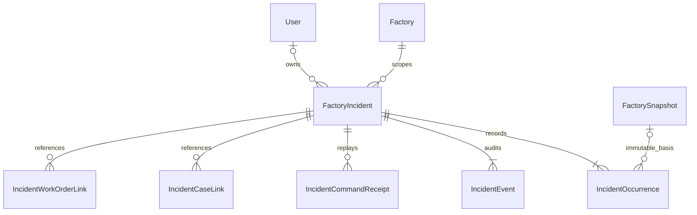
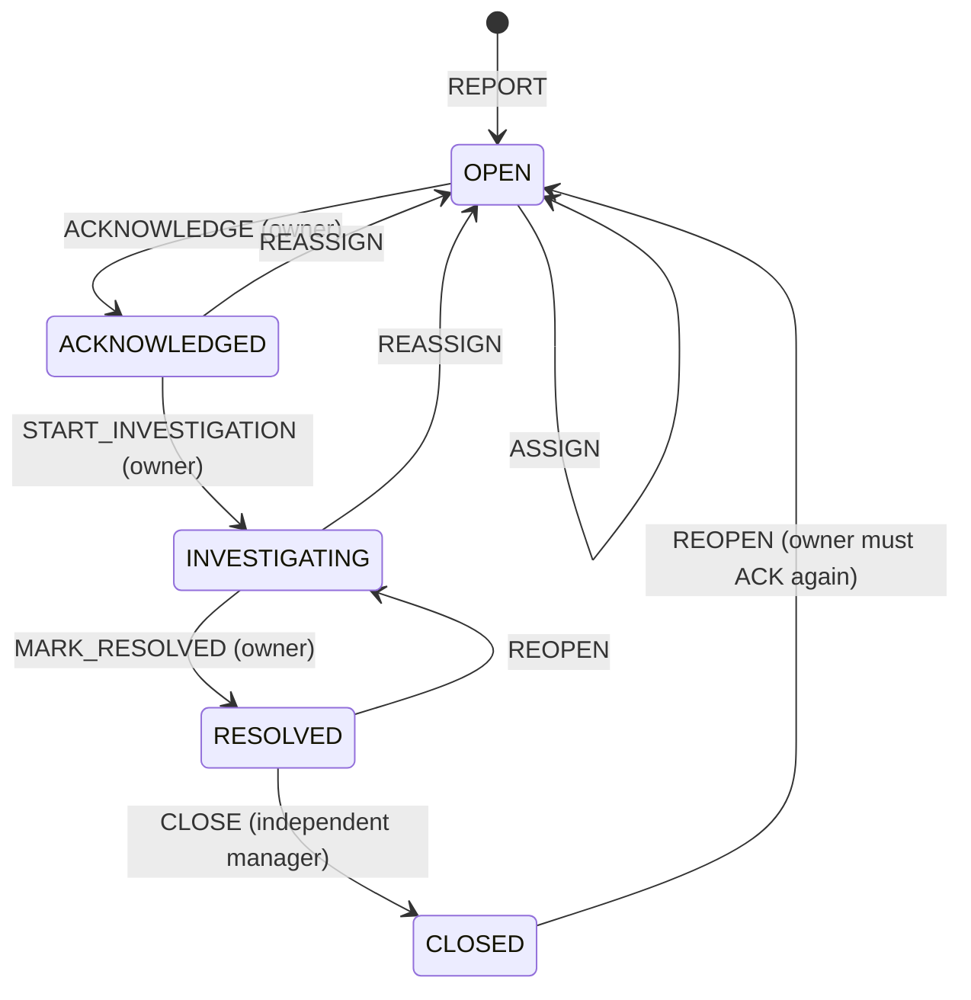

# Factory Incident Center — draft contract and implementation plan

Baseline: main `f4b210265fd49e0459536fdcc642081d03e62cfb`, 2026-10-22.
Branch: `codex/factory-incident-center`. Draft only; never auto-merge.
Factory access #46 (`20174dff2ea27b969cf2cf9ed356a61496e5fd14`) and Overview
#47 (`86ed39fdd30713af8d49d798d1e0fe7e3ddefac0`) are merged.
Work Orders dependency: [draft #48](https://github.com/AIVIETNAM-AIO-BachNguyen/reinforcement-learning-cnc/pull/48)
at `a41359fb3a16f4a6e8bf82cc773e4b350f426aff`. This branch does not merge or modify
Work Order tables/services. Linked-service acceptance remains pending implementation
and a pinned integrated SHA. Draft DTO authority: [incidents OpenAPI](incidents.openapi.yaml).
Examples: [incident requests](../examples/incidents.json).

## Agreed product decisions

User confirmed routes `/operations/incidents` and `/operations/incidents/{id}`.
One Overview remains; no parallel factory dashboard. Incident detail links to
`/operations/recommendations?caseId=<UUID>`, never research `/decisions`.

Severity is an accountable human classification, not a computed risk threshold:
INFO = recorded issue needing awareness/review; WARNING = issue requiring planned
investigation/action; CRITICAL = issue requiring prompt management review. These
labels do not authorize machine control or express an SLA or probability threshold.
User approved nullable official severity (`null` = awaiting confirmation).
OPERATOR may propose a level but only ADMIN/ENGINEER may establish/change official
severity. A HEALTH_ALERT trigger has no official severity field in v3: never infer
severity from its probability/threshold. Preserve proposed and confirmed values and
all subsequent changes in history. No telemetry scanner or automatic incident creation.

User approved manager override of a known nonterminal linked Work Order with a
separate reason. Target unavailable is not terminal and cannot be overridden.
No override bypasses scope, state, independent verification or owner requirements.

## Ownership and integration order

Flex owns incident models, migration, service/routes, DTOs, desktop pages, clients,
tests and runbook. Reserve `20261022020000_factory_incidents`; Backend #48 reserves
`20261022010000_maintenance_work_orders`. Existing migrations are immutable.
Coordinate sequential edits to Prisma schema, backend router/OpenAPI/exporter and
frontend navigation. This draft changes none of those shared files yet.
The separate OpenAPI is a proposal, not an endpoint already deployed. Before
implementation/export integration, copy reviewed schemas/paths into the authoritative
backend OpenAPI and regenerate using the existing exporter; never hand-edit exports.

Incident UUID; factory FK; optional owner User FK; revision initially 1; category
EQUIPMENT/PROCESS/SAFETY/OTHER; title/description; optional scoped machine/basis
pair; severity/proposal; OPEN/ACKNOWLEDGED/INVESTIGATING/RESOLVED/CLOSED;
first/last occurrence timestamps/count; acknowledgment, latest resolution and
closure metadata. Historical resolution/verification remains in append-only events.
No hard-delete endpoint. Reference projections include historical/current labels;
display names never establish machine or user identity.

Occurrence: UUID, incident/factory, immutable source type + source ID, basis/machine
and sanitized evidence projection, server actor and recorded time. Unique
(factory, source_type, source_id), including CLOSED incidents. Manual source IDs
are client UUIDs for the logical report; from_case source ID is the authorized case
UUID. Read source fields from immutable request/basis, never client-supplied evidence.
Allowlisted HEALTH_ALERT evidence includes trigger event/time, machine identity,
failure_probability/alert_threshold and matching health references with only their
actual time/model/horizon/value fields. Missing fields stay missing; no raw request,
planner artifact, private notes or invented sensor history.

Event: incident FK, unique incident/sequence, command, actor FK, server occurred_at,
allowlisted payload. Immutable occurrences/events/receipts enforced at DB level.
Receipts: separate module namespace, unique(factory,actor,key), operation+target+
normalized body hash, original status/body. State/event/AuditLog/receipt in one
transaction. Links retain immutable creation metadata and unlink metadata; unlink
does not erase history. No FK to WorkOrder until both owners agree migration integration.

## Lifecycle

Create: OPERATOR/ENGINEER/ADMIN with scope. Assign/reassign: ADMIN/ENGINEER;
target active scoped OPERATOR/ENGINEER, never canonical technician ID. Reassign
requires a reason and different owner; no reassignment from RESOLVED/CLOSED.
Owner commands require fresh active eligibility and current ownership even on receipt
replay. Reopen RESOLVED returns INVESTIGATING even if the retained owner lost access;
that owner cannot issue commands, and a manager must REASSIGN (returning OPEN).
CLOSED reopen returns OPEN, retains historical ownership and requires reassignment if ineligible.
Neither manager role nor override permits impersonating the owner.

MARK_RESOLVED requires code FIXED/FALSE_POSITIVE/NO_ACTION_REQUIRED, nonblank
summary and verification evidence text. Evidence text is a user report, not a claim
of sensor/physical recovery. CLOSE requires ADMIN/ENGINEER different from latest
resolver, nonblank verification and confirmed severity. FALSE_POSITIVE and
NO_ACTION_REQUIRED require explicit verification of the resolution code. No case
or Work Order is mandatory. REOPEN requires reason and preserves previous attempts.
CHANGE_SEVERITY requires manager, level and reason, including initial confirmation.

MARK_RESOLVED and CLOSE inspect all active Work Order links through the producer
service in the same write transaction. Only CLOSED/CANCELLED are terminal per #48;
COMPLETED is still awaiting verification. Manager owner can MARK_RESOLVED with a
nonterminal override; independent manager can CLOSE with its own override reason.
Unavailable/missing target fails closed, never pretends terminal. Neither side
mutates or automatically closes/cancels the other module or changes published schedules.

## Source deduplication, recurrence and links

Reporting same case source returns the existing incident/occurrence, even if CLOSED,
without increment or reopening; return a receipt for this successful logical request.
Manual source ID with a changed report body is 409 INCIDENT_SOURCE_CONFLICT.
Unique insert/transaction serialization enforces dedup, not unlocked find-then-insert.
APPEND_OCCURRENCE is an explicit manager command requiring expected_revision and
new validated source. Only OPEN/ACKNOWLEDGED/INVESTIGATING; factory/category and
machine identity must match. Same source already on this incident is a no-op after
fresh authorization/receipt checks, no revision/count/event increase. A source owned
by another incident is 409 INCIDENT_SOURCE_ALREADY_LINKED. Moving/merging historical
occurrences is unsupported. New sources on the same machine list related incidents;
the user explicitly chooses append or creates a distinct incident (reason required
when a related incident exists). CLOSED sources are never automatically reopened.

From-case accepts only LIVE with validated HEALTH_ALERT and valid scoped machine
in its immutable basis. SIMULATION_ONLY is not an operating incident. Generic case
links may reference an authorized LIVE case lacking machine evidence but must display
`association_scope=case`, not a fabricated machine association. A case with trusted
machine identity must match a machine-specific incident. Links do not create cases,
approve/commit plans or generate Work Orders.

WorkOrderSummary is owned by #48. Use `lookupWorkOrderSummaries(tx,user,{factory_id,ids})`
at the pinned reviewed implementation, batches <=50. Match factory and machine for
machine-specific incidents; preserve both immutable basis identities, do not replace
old evidence with current entity values. No arbitrary target URLs or duplicated DTO
guesses. No fabricated href: route ownership belongs to Frontend. Until target service
exists, return 503 INCIDENT_LINK_TARGET_UNAVAILABLE for dependent operations, not mock success.

## API, concurrency and read semantics

All routes authenticated and no-store, product error envelope with requestId. Scoped
404 hides missing/inaccessible IDs. Reuse #46 `lockFactory`, ordered `lockUsers`,
`currentUser`, `authorizeFactory`; no second permission model. Write lock order:
factory -> sorted actor/owner users -> incident -> sorted linked target rows.
Fresh role/membership/owner checks precede receipt replay; revoke wins writes/replay.
Expected revision mismatch 409 INCIDENT_REVISION_CONFLICT; key/body mismatch 409
IDEMPOTENCY_KEY_REUSED. GET/poll/refresh never writes incidents or upstream services.

List AND filters: required factory_id; status,severity,owner_user_id,machine_id,q.
q trimmed 1..200, searches title/description server-side only, bound query values.
Limit default25/max100; created_at DESC,id DESC only; signed cursor binds actor,
factory and normalized filters, preserving microseconds. No client-side global search.
Summary covers entire authorized factory, not page filters: total, every status,
confirmed severity buckets, unconfirmed_severity, unassigned, awaiting_verification,
read_at. No overdue/SLA metric. Elapsed age/unacknowledged time are timestamp labels.
Events/occurrences use ascending immutable sequence (after_sequence, limit max200).
Read snapshots are individually consistent, not a cross-page global snapshot.

Link/unlink require same Idempotency-Key/revision rules. DELETE body contains
expected_revision and reason; receipt hash includes incident and link UUID. A link
creation duplicate to the same active target is a no-op, not a second link/event.
Unlink requires manager reason; closure guards inspect currently active links and
audit removed links. Response metadata always provides current revision and available
commands, but command guards run again server-side. Historical receipts require
refetch before new commands; lost response keeps exactly the original key/body.

## Desktop handoff and acceptance plan

List: global counts; URL-scoped factory/filters/search; server pagination;
status/severity/owner/source/age; keyboard actions. Detail: state/owner -> evidence
-> next action -> links -> timeline. Manual/from-case report dialog is explicit.
Pending severity is textual, not green. No optimistic command success or automatic
new key retry. Stale revision shows review/refetch. Loading, empty, scope denied,
unavailable, missing evidence, integrity and conflict remain distinct. Old factory
requests abort/ignore, no scope flash; URL changes apply only after committed navigation.
Desktop widths1280/1440/1920; retain existing mobile regressions, no mobile redesign.

Test plan (not evidence yet):
- PostgreSQL authenticated HTTP with two registered factories, all roles, active/
  revoked memberships, owner/non-owner and inactive users; links outside scope.
- Same key/source, changed manual payload, closed-source replay, new recurrence,
  concurrent create/append/reopen; rollback leaves no orphan receipt/event.
- Every transition, role, revision, severity confirmation and independent verifier;
  owner loss and reassignment; locked revoke wins against writes and replay.
- Genuine HEALTH_ALERT vs SIMULATION_ONLY masquerade; immutable evidence projection,
  case-level links without fake machine, no raw source leakage.
- Work Order CLOSED/CANCELLED/COMPLETED/active/unavailable, explicit override audit,
  no lifecycle coupling. Pending until producer implementation/integration exists.
- Summary >page limit, search AND filters, cursor scope, event pagination and reload.
- Client/hooks/components: lost-response receipt, delayed scope switch, refresh race,
  committed URL navigation; preserve #44 and prior Operations regressions.
- Real service flow from report through assign/ACK/investigate, case APPROVE/COMMIT,
  Work Order execution/closure via Backend APIs, incident resolve/verify/close/reopen;
  false-positive path without mandatory case/workorder; revoke path.
- Fresh and populated exact-base upgrade with both migrations; full CI/build/contracts.
- Three consecutive clean-schema runs at same combined SHA, desktop screenshots and
  cleanup logs. No passed marker for unavailable/skipped linked E2E.

Contract-first checkpoint was published before implementation. Initial independent
implementation is now in `src/services/incident-policy.js`: strict discriminated
request validators and pure transition guards/patches. It deliberately does not
perform authorization lookup, transactions, receipt replay or source projection;
the future transactional service must supply freshly authorized actor/owner/target
data under #46 locks. Policy tests are not PostgreSQL or HTTP evidence.

Remaining: freeze field-level evidence projection, incident persistence/migration,
transactional API/auth/dedup/audit, desktop client/UI, real two-factory tests and
combined Work Order integration. All end-to-end acceptance is still pending.
