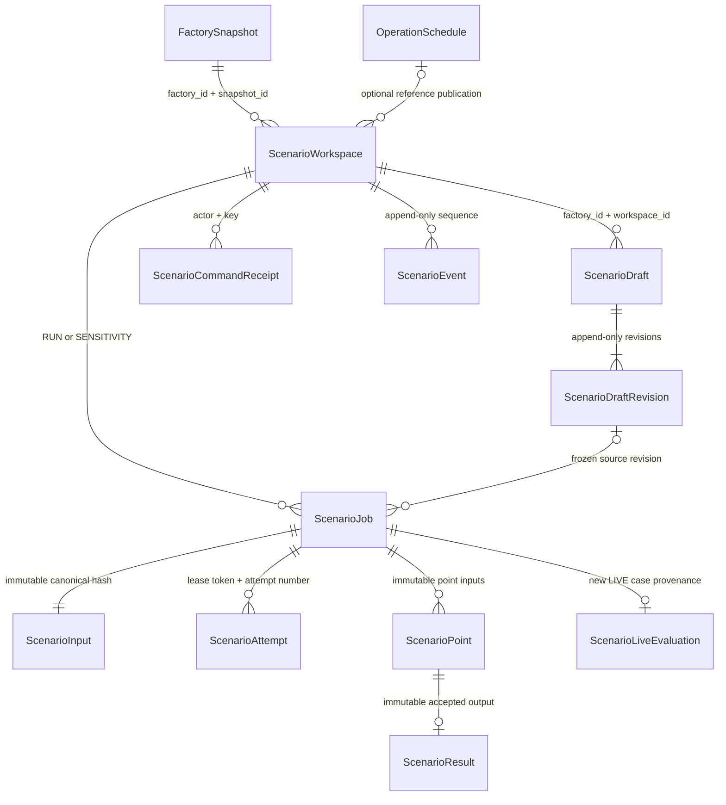

# Scenario Planning — M0 contract proposal

Base: `c926d5d24566834850cf4a16af0792af9c7d50fd` (fetched 2026-10-27).
Branch: `feat/scenario-planning-backend`. Status: M0 in progress, not API_READY or VERIFIED_DONE.
Scope follows the shared 2026-10-27 brief. No dependency on Incident APIs.
Flex engine and Frontend dependency SHAs are pending; this proposal is not a claim of joint approval.

Review artifacts: `scenario-planning.openapi.json`, `scenario-planning.d.ts` and
`scenario-planning-examples.json`. Regenerate/check the proposal with
`node scripts/export-scenario-contract.js [--check]`. The OpenAPI explicitly labels
the two unresolved Flex response schemas; it is not yet added to the served API
or advertised as a frozen consumer contract. Request policy tests run with
`npm test -- --runInBand tests/scenario-policy.test.js`.

Proposed validation bounds needing joint review: maintenance duration 1–43200 minutes,
planning horizon 1–43200 minutes, each weight 0–1000000 and their sum >1e-12 (matching
the canonical nonzero tolerance). Sweeps require explicit 1–7 unique values; clients
default to five rather than relying on unspecified server-generated ranges.

## Persistence and integrity

Every child carries factory/workspace scope and composite foreign keys, not only a globally unique UUID. References use RESTRICT; no hard-delete API. Workspace baseline snapshot/hash, publication identity/hash/plan version and planning/sampling/engine configuration are immutable. Draft changes append a revision and advance the current revision using a compare-and-swap. Enqueue copies the referenced revision into an immutable input in the same transaction as the job, audit event and receipt. Engine-effective snapshot, hash, transformation diff and versions are persisted as immutable output, never registered as an Operations snapshot/head.

Run input includes both a no-overrides baseline evaluation and the scenario evaluation with identical objectives/config/engine/sampling. Reference publication is a separate historical reference, not the computed baseline. A sweep has separately persisted ordered points; unsuccessful points cannot disappear. Retry appends an attempt and uses the original input. Result uniqueness and a live, unexpired lease-token fence prevent late workers from replacing accepted output.

## Authorization and serialization

Active ADMIN/ENGINEER may create/edit/enqueue/handoff. Active OPERATOR/VIEWER may read within factory access. No owner-private ACL. All access uses the existing factory-access service and selected authorization source. Writes take the existing factory advisory lock, then ordered user row locks, then freshly check active/global role/membership before reading any receipt. A revoke that wins the factory lock blocks writes and receipt replay. Worker execution is system work and does not impersonate the creator.

Reads use a consistent transaction and never mutate jobs or Operations state. Missing/inaccessible workspace/run IDs return the same 404. Errors and successes have no-store and correlation headers. Cursors bind actor, factory, workspace and filters; list order is created_at DESC/id DESC with timestamp precision preserved. Default limit 20, maximum 100. Compare accepts 2–4 unique completed run IDs from one workspace.

## Job and engine boundary

Job status: QUEUED/RUNNING/SUCCEEDED/FAILED. Evaluation outcome: FEASIBLE/NO_FEASIBLE_PLAN. Point status: QUEUED/RUNNING/FEASIBLE/NO_FEASIBLE_PLAN/FAILED/TIMEOUT. Sweep outcome: COMPLETE/PARTIAL_FAILED/FAILED. NO_FEASIBLE_PLAN is a completed domain evaluation, not an infrastructure error. COMPLETE means every point evaluated; it does not imply every point feasible.

Proposed bounded policy: 3 supported strategies, 7 unique sweep points, 1000 Monte Carlo draws/point, 30 seconds solver/point and 300 seconds total job deadline. Attempts are bounded; overall deadline never resets on retry. Claim/reclaim and persistence are short transactions; planner calls run outside them. Engine endpoint is server-configured, never accepted from a request. Responses must match the frozen scope/input hash/schema/engine/sampling identities and pass typed validation before persistence.

Flex owns effective transforms, candidate evaluation, metrics, comparisons, normalization references, tie-breaks and rank-change intervals. Node must not calculate scores. Weight sweeps rerank the same candidate set/KPIs/normalization reference. Physical sweeps re-plan each point. UUIDs/attempt identities cannot seed simulation randomness. A joint versioned sampling contract remains required before real-engine acceptance.

## LIVE boundary finding

At the exact base SHA, canonical `ManualReplanTrigger` has no maintenance earliest-start override. `earliest_start_at` belongs to the canonical snapshot maintenance request. Therefore DEFER_MAINTENANCE cannot currently be represented in a new LIVE request without a coordinated canonical/engine extension. Return an explicit unsupported-mapping conflict until that extension is reviewed and integrated; do not hide it in WHAT_IF or mutate the snapshot. Objective weights already exist in PlanningConfig and can map to a fresh MANUAL_REPLAN case. Technician availability/duration overrides are rejected for handoff; real authorized ingestion must update actual facts separately.

LIVE handoff requires a saved completed run, explicit confirmation and the expected current head. A stale workspace is rejected, never silently rebased. The transaction creates a new LIVE case and records scenario/run provenance; no simulation candidate/schedule is copied. Existing planner, approval, commit and Work Order guards remain authoritative.

## Migration and verification plan

Reserve a new migration under `20261027010000_scenario_planning`; verify collision again before publication. Add tables/indexes/constraints without rewriting existing canonical JSON, receipts, publication versions or history. Validate fresh schema and populated upgrade from the exact base, plus the actual integrated branch when Flex/Frontend dependencies exist.

Required evidence: authenticated HTTP/PostgreSQL two-factory/all-role checks, revision/enqueue races, revoke/replay, worker lease expiry/fencing/restart, malformed outputs, partial timeout, rollback, historical baseline preservation and LIVE boundaries. Real Flex baseline→override→5-point physical sweep→5-point weight sweep→compare/replay is mandatory. Three clean-schema joint browser runs and full CI at one integrated SHA remain prerequisites for VERIFIED_DONE. Mocks cannot satisfy these gates.
