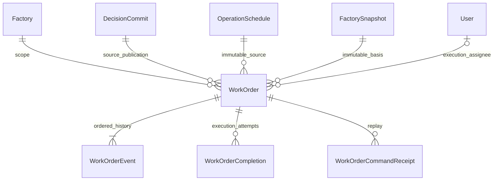
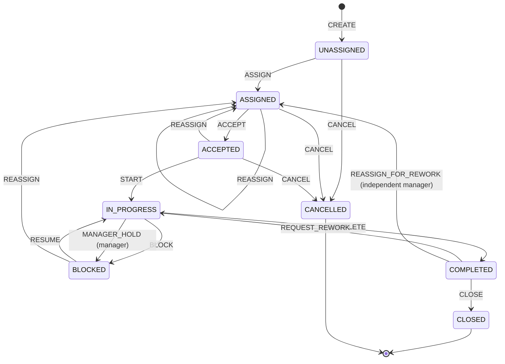

# Maintenance Work Orders — backend contract

Implementation base main: `f8d94837159ca5fdc1a0f159fc8c28f75e394f7f` (2026-10-24).
Original contract base: `f4b210265fd49e0459536fdcc642081d03e62cfb`.
Dependencies #46 (`20174df`) and #47 (`86ed39f`) are merged. Branch:
`feat/maintenance-work-orders-api` (follow-up to merged contract PR #48). Draft only; no automatic merge or production deployment.
Incident contract #49 at `4469b78` is merged into this base and has no database
migration. Combined upgrade testing remains pending the actual migration artifact. The coordination document assigns incident tables,
links and incident UI to Flex; this PR owns Work Orders only.

## Inventory and ownership

Maintenance v2 records research recommendation reviews, referencing episodes and
research observation steps. Reuse its strict validation/atomic audit technique,
not its identity, time model or lifecycle. Work Orders reference committed v3
publications and UTC wall-clock timestamps; domain schema 3.0 stays unchanged.

Shared integration files: backend/openapi.yaml, prisma/schema.prisma,
src/routes/v1/index.js, scripts/export-operations-http-contract.js and generated
contracts/v3/operations-http.openapi.json. Regenerate the export after sequential
integration with Flex; never overwrite its incident paths/models. New migration
reserved: `20261022010000_maintenance_work_orders` (Backend owner).

WorkOrder UUID is independent of case, assignment and research identity. A composite
publication FK carries factory, case, schedule ID/revision, schedule hash, basis and
published plan version together; the existing publication FK guarantees schedule and
basis existence. A direct Factory FK makes scope explicit. Assignment/machine/request
are embedded canonical identities: a DB insert guard verifies their JSON membership
and immutable projection against that publication/basis. No FK to Flex-owned tables.
All historical FKs restrict deletion; no hard-delete endpoint. Immutable source fields,
append-only event/completion/receipt tables and revision guards protect direct writes.
Unique origin is (factory, schedule ID/revision, assignment ID), including terminal
orders. A partial unique index prevents two nonterminal orders for one
(factory, basis snapshot, maintenance request). Factory serialization also checks
same-machine half-open planned windows [start,end); touching windows do not overlap.
An explicit `overlap_override_reason` permits overlap with durable event/audit context;
it never bypasses origin or active-request uniqueness.

## Lifecycle and roles

ADMIN/ENGINEER create, ASSIGN/REASSIGN, CANCEL, CLOSE and REQUEST_REWORK. Assignees
must be active OPERATOR/ENGINEER with factory access from the configured #46 source.
ACCEPT/START/BLOCK/RESUME/COMPLETE require the current assignee with a fresh eligible
role/access check. VIEWER only reads. ADMIN cannot bypass state/assignee guards.
CLOSE/REQUEST_REWORK must be performed by a different user from the latest completion
reporter. Rework requires a still-eligible assignee; otherwise409 ASSIGNEE_UNAVAILABLE.
If the previous assignee is unavailable, use REASSIGN_FOR_REWORK from COMPLETED:
an independent ADMIN/ENGINEER supplies a different active scoped OPERATOR/ENGINEER
and a nonblank reason. It increments attempt, retains immutable completion history
and original actual_started_at, clears the current actual_completed_at, and enters
ASSIGNED. The new assignee must ACCEPT then START; no false verification or access
restoration is required. Independent verification still applies to each completion.

CANCEL also requires actual_started_at=null, including after reassignment. START
preserves the original actual_started_at when an already-started order is reassigned.
An inactive/revoked assignee in IN_PROGRESS cannot report. ADMIN/ENGINEER can use
MANAGER_HOLD with a nonblank reason to enter BLOCKED, then REASSIGN to an eligible
replacement. MANAGER_HOLD is a distinct audited managerial act, not a BLOCK attributed
to the old assignee. Preserve actual_started_at and all reports; do not regrant access,
reset execution or claim the machine physically stopped. The replacement must ACCEPT
then START. These commands require fresh manager authorization, factory/user locks,
expected_revision and receipt handling just like existing commands.
REASSIGN from BLOCKED is supported and requires a reason and a new eligible assignee.

BLOCK, RESUME, REASSIGN, CANCEL and REQUEST_REWORK require nonblank reasons.
COMPLETE requires work_performed, result and outcome SUCCESS/PARTIAL/STOPPED; STOPPED
also requires stop_reason. CLOSE requires verification result VERIFIED or
VERIFIED_STOPPED plus a note; STOPPED reports require VERIFIED_STOPPED. Each COMPLETE
inserts an immutable completion attempt. REQUEST_REWORK increments attempt, retains
old reports/events and clears only the current actual_completed_at. The original
actual_started_at is never reset. Historical reports remain in paginated events.

## HTTP and concurrency

Authority: [OpenAPI](../openapi.yaml), [examples](../examples/work-orders.json).
Strict bodies/query fields; no caller actors, timestamps or free status mutation.
Product envelopes and X-Request-Id; Cache-Control:no-store for success/errors.

POST /work-orders uses source publication/assignment plus expected_head (current
snapshot_id, head revision and published plan_version). The source basis can differ
from the current telemetry snapshot. New creation requires the current committed
publication; APPROVED candidates, SIMULATION_ONLY, production/blocked assignments
and seed schedules without DecisionCommit are rejected. Source payload hashes and
canonical validation must pass. Later P2 never rebases/cancels an existing P1 order.

Tokens remain distinct: case revision, candidate version, published plan_version,
schedule revision and head revision retain their existing meanings. WorkOrder.revision
is a separate command token. Every mutation requires Idempotency-Key; order commands
also require expected_revision. Receipt namespace is the separate work-order table,
unique(factory,actor,key); normalized request hash includes operation and target ID.
Same key/body returns the original status/body without another event, even after later
state/head changes; a different body/operation gives409 IDEMPOTENCY_KEY_REUSED.
Receipt responses are historical; re-read before issuing the next command.

Lock order: factory advisory lock (#46 namespace), ordered actor/target user SHARE
locks, then work-order/source/head rows. Fresh DB active/role/access authorization
precedes receipt replay, even after waiting. Grant/revoke uses the same factory lock;
user administration uses ordered user UPDATE locks without acquiring factory locks.
Actor access or role loss denies replay. Execution-command replay also requires the
caller still be the current eligible assignee; reassignment is not bypassed by a key.
State, immutable event, completion attempt, AuditLog reference and receipt commit in
one transaction. No separate worker, dispatcher, telemetry or publication mutation.

List filters are AND: factory_id required; optional status, assignee_user_id UUID,
machine_id (historical scoped identity), overdue=true/false. Limit25 default/max100.
Stable created_at DESC,id DESC; signed opaque cursor binds actor/source/factory/filters
and an overdue cutoff read_at. Microseconds are preserved. No cross-page snapshot is
promised for changing data. `read_at` is UTC RFC3339; planned/actual times are UTC;
duration requirements use minutes. Overdue means planned_end_at < read_at and not
CLOSED/CANCELLED. COMPLETED is nonterminal but separately waiting_verification=true.
Actual elapsed time is neither machine downtime nor labor hours.

Events use after_sequence (default0), limit100/max200, ascending gap-free per-order
sequence, actor user ID, server occurred_at and command. Public payload is allowlisted;
scoped detail/events may contain reports, summaries never contain reports/notes.
No read changes order/head/schedule. Source_is_current compares publication identity,
not current telemetry basis. machine_in_current_snapshot is nullable when no head.

## Flex lookup contract

GET /work-orders/summaries?factory_id=...&ids=UUID,UUID returns up to50 unique IDs
in input order, all-or-nothing scoped404 on any missing/inaccessible target. No notes,
reports or raw artifacts. WorkOrderSummary contains ID, factory/machine/basis, source
publication/assignment, revision/status, assignee summary, planned/actual timestamps,
source_is_current, machine_in_current_snapshot, overdue and waiting_verification.
UI owns the detail route map; no fabricated frontend href is returned.

Service `lookupWorkOrderSummaries(tx,user,{factory_id,ids})` accepts a Prisma transaction
client and performs fresh shared factory authorization. Flex link writes first follow
the shared lock order, check both objects in that transaction, then compare factory
and machine identities; lookup never grants access. HTTP reads use RepeatableRead.
Do not treat503 as deletion/completion. IncidentWorkOrderLink is owned by Flex and is
not auto-created by this module; closing either object does not close the other.

## Test and rollout plan

Authenticated HTTP + real isolated PostgreSQL: real case APPROVE/COMMIT source,
full lifecycle/rework/reassignment, two factories/roles, immutable old publication,
origin/active-request/overlap policy, strict inputs/cursors/time, replay, coordinated
revocation/head/state races, audit/receipt rollback and direct DB constraints.
Exact-base fresh/populated upgrade must preserve existing snapshots, schedules,
hashes, cases, publications, membership and audit; combine Flex migration when its
SHA is available. Existing Operations, planning and access suites remain required.
CI Contracts and Operations integration must be green at the final head.

Deploy additive migration before code; no backfill of work orders or automatic spawn.
Keep factory access mode consistent with #46. Roll back application routes only after
quiescing Work Order writes; retain new history/tables and restrict FKs. Never drop
orders/events or restore an old env grant map. Curl and two-factory smoke instructions are
available in [the runbook](work-orders-runbook.md). Full Work Order UI is a separate frontend task.

## Recovery implementation

The transactional service calls the merged pure recovery guards after fresh manager
and target-user authorization under the shared locks. State, event, report history,
audit and receipt use the same transaction. PostgreSQL tests cover revoked-assignee
recovery, both revoke/write serialization orders, historical replay and injected
audit rollback. See [runbook](work-orders-runbook.md) for executable demo setup.
