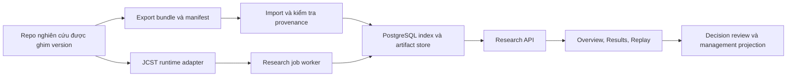

# Kế hoạch chuyển repo sang nền tảng hỗ trợ nghiên cứu JCST

Ngày: 30/10/2026, Asia/Taipei. Trạng thái: **kế hoạch v1; triển khai và bằng chứng được theo dõi tại [implementation report](research/implementation-report-2026-10-30.md)**.

## 1. Mục tiêu và cơ sở lập kế hoạch

Đưa `reinforcement-learning-cnc` thành **Maintenance Demand–Capacity Coordination Research Platform**: công cụ quản lý bằng chứng, phân tích kết quả, replay và minh họa quyết định cho nghiên cứu trong `maintenance-capacity-coordination`. Ứng dụng quản lý bảo trì là lớp sử dụng kết quả nghiên cứu, đứng sau chức năng nghiên cứu trong thứ tự triển khai.

Material Passport: loại tài liệu = kế hoạch chuyển đổi phần mềm phục vụ nghiên cứu; đầu vào = source, contracts, protocol và findings đã đọc; không tạo dữ liệu khoa học, không xác nhận lại kết quả bằng thực nghiệm; mọi đường dẫn mới/API/model dưới đây là thiết kế dự kiến cho đến khi được triển khai và kiểm thử.

Baseline đã đọc:

- Workspace ứng dụng: HEAD `7a734bfcec7d42627fb2eb2e9a0dbba12e00c3de`, kèm các sửa đổi/untracked đang có. Không coi HEAD là toàn bộ trạng thái làm việc và không ghi đè các sửa đổi đó.
- Repo nghiên cứu công khai: commit `ff3bd63aac325003ab72fbb883f8015d83f38cb7`. Checkout nghiên cứu trên máy tại thời điểm đọc: `67056a54ec8708d2b46889f77ddd67aa0d61612e`.
- [CURRENT_STATE](https://github.com/AIVIETNAM-AIO-BachNguyen/maintenance-capacity-coordination/blob/ff3bd63aac325003ab72fbb883f8015d83f38cb7/CURRENT_STATE.md), [source handoff](https://github.com/AIVIETNAM-AIO-BachNguyen/maintenance-capacity-coordination/blob/ff3bd63aac325003ab72fbb883f8015d83f38cb7/docs/jcst_source_handoff.md), [physics](https://github.com/AIVIETNAM-AIO-BachNguyen/maintenance-capacity-coordination/blob/ff3bd63aac325003ab72fbb883f8015d83f38cb7/src/ht_pdm_fjsp/component_service_v1.py), [S/F/A](https://github.com/AIVIETNAM-AIO-BachNguyen/maintenance-capacity-coordination/blob/ff3bd63aac325003ab72fbb883f8015d83f38cb7/src/ht_pdm_fjsp/jcst_learner_v1.py), [SE1 findings](https://github.com/AIVIETNAM-AIO-BachNguyen/maintenance-capacity-coordination/blob/ff3bd63aac325003ab72fbb883f8015d83f38cb7/docs/jcst_sample_efficiency_se1_findings.md).
- Inventory là kiểm tra source/tài liệu, chưa phải chứng nhận runtime hoặc tình trạng các PR ở checkout khác. Work Orders, Incident Center, Maintenance Analytics và Scenario Planning xuất hiện trong các task briefs; schema/routes đang đọc chưa chứng minh toàn bộ các module đó đã triển khai. M0 phải xác nhận lại trước khi giao việc.

Đích nghiệm thu toàn repo: một người nghiên cứu mở campaign, kiểm tra protocol/provenance/audit, so sánh đúng các arm và replay quyết định bằng JCST; một người quản lý xem hoặc thử quyết định trên bản sao mô phỏng có cùng ngữ nghĩa. Không cần hệ quản lý sản xuất hoàn chỉnh để đạt đích này.

## 2. Các quyết định kiến trúc làm mặc định

1. **Hai repo, một nguồn chuẩn cho khoa học.** Repo nghiên cứu sở hữu physics, encoding, controller, training, evaluation, statistics và research gates. Repo ứng dụng sở hữu API, lưu trữ/index, quyền, job lifecycle và presentation. Adapter gọi implementation được ghim phiên bản; không sao chép rồi sửa physics trong web repo.
2. **Ưu tiên đọc kết quả trước chạy mới.** Bản đầu nhập findings/analysis/trace có provenance. Tiếp theo replay, engineering simulation, rồi inference từ checkpoint đã xác minh. Điều khiển full scientific training từ web là mở rộng về sau, không phải điều kiện hoàn tất migration này.
3. **Contract JCST là một family riêng.** Dùng `contracts/jcst/v1`, không đổi nghĩa contract CNC v2 hoặc operations v3. `wire_schema_version`, `simulator_version`, `adapter_version`, `protocol_version` và `checkpoint_hash` là các định danh độc lập.
4. **Mặc định nghiên cứu là actor tập trung PPO S/F/A.** Giữ cả ba arm và controls trong catalog. A là lựa chọn cấu trúc đơn giản được bằng chứng hiện tại hỗ trợ, không tự chọn một checkpoint A bất kỳ thành mặc định triển khai.
5. **Chức năng quản lý dùng projection và provenance.** Approval/work order không đổi lịch sử episode hoặc trở thành điều kiện admission mới của JCST. Override tạo nhánh mô phỏng riêng, áp dụng trước transition của nhánh đó.
6. **Giữ nền tảng hiện tại.** Tiếp tục Express/Prisma/PostgreSQL, Next.js, FastAPI. Tái sử dụng lease fencing, idempotency, audit và transaction patterns sau khi tách khỏi v2-specific payloads.
7. **Runtime nghiên cứu tách môi trường AI orchestration.** Một process/service adapter có Python 3.12 và dependency lock tương thích nguồn nghiên cứu; FastAPI/Node không phải cài Torch để chỉ đọc kết quả. Không ghép hai lockfile bằng cách nâng/hạ dependency tùy ý.

## 3. Ngữ nghĩa phải khớp nghiên cứu

| Chủ đề | JCST/1.1 phải được giữ |
| --- | --- |
| Đơn vị | Tick và simulation cost unit; wall-clock timestamp chỉ là metadata. Chưa tự đổi tick thành phút hay chi phí thành tiền thật. |
| State | Mỗi máy có các component với age/failed; mỗi technician có job hoặc idle, target, kind và remaining. |
| Action | Complete partial matching các bộ `(machine, component, technician)`, gồm matching rỗng WAIT; tối đa một service mỗi máy và mỗi technician. |
| Eligibility | Technician rảnh và duration dương; PM trên component khỏe ở bất kỳ tuổi hợp lệ, CM trên component hỏng. Không có ngưỡng work-order admission bắt buộc. |
| Transition | Starts tại boundary trước interval; service non-preemptive; technician bị giữ đến completion; chỉ reset target component. |
| Production | Máy chỉ working khi không service và không component nào failed. Tuổi các component chỉ tăng trong interval máy working. |
| Noise | Key theo physical seed/tick/machine/component, độc lập ID UI/schedule. Future physical realizations không vào observation của controller. |
| Objective | PM + CM + unavailable-machine intervals + new failures theo hệ số config; H và fixed-risk tail lưu riêng, tổng H+tail không bị tính hai lần. |
| Scope | Base: 3 máy × 2 component, 2 technician; generalist thêm technician thứ ba. UI có thể linh hoạt, nhưng claim/inference chỉ cho config được xác nhận. |

Không đưa FIFO, travel, spare inventory, RUL posterior, CVaR, production jobs/deadlines, arbitrary objective weights hoặc luật risk giảm 70% vào JCST dưới cùng version. Các cơ chế này có thể thuộc domain vận hành riêng hoặc nghiên cứu tương lai với contract mới.

## 4. Inventory: giữ, đổi và kết thúc vai trò cũ

| Phạm vi hiện tại | Xử lý | Đầu ra sau migration |
| --- | --- | --- |
| `README.md`, `DEV-LOCAL.md`, README từng service | Viết lại định hướng và capability matrix | Hướng dẫn chạy Research Platform; trạng thái từng adapter/dataset rõ |
| `contracts/v2`, `domain/cnc`, generated CNC types | Giữ legacy, không map field bằng đổi tên | Lịch sử thay dao vẫn đọc đúng nghĩa |
| `contracts/v3`, `domain/operations/contracts.py` | Giữ cho nghiệp vụ vận hành; bridge có version | Không dùng schedule/health snapshot v3 để giả làm full JCST state |
| `domain/operations/policy.py` | Kết thúc vai trò default; giữ adapter legacy nếu còn consumer | JCST controller port thay input 2-agent/13-action/290-feature |
| `domain/operations/simulator.py`, `scoring.py`, `scheduler.py` | Cô lập trong legacy operations planner | Không cung cấp KPI/score khoa học cho JCST |
| `agent_workflow.py`, LangGraph/OpenRouter | Giữ optional; đổi catalog/prompt/handoff | Evidence explanation đọc kết quả thật, không chọn action thay policy |
| `backend/src/engine/*`, episode worker | Tái dùng lifecycle sau tách v2 event validator | Research import/replay/engineering jobs có payload family riêng |
| Prisma Experiment/Episode/observation v2 | Giữ dữ liệu và migration history; thêm research tables | Không ALTER ý nghĩa payload cũ thành JCST |
| Auth/users/audit/idempotency/leases | Tái dùng theo phạm vi access đã chốt | Quyền research độc lập với technician và factory membership |
| Decision cases/recommendations/commit | Giữ operations workflow; thêm liên kết research khi biểu diễn được | Snapshot/action provenance, không ngầm biến matching thành lịch sản xuất |
| Frontend `/overview`, shell | Đổi default sang research overview | Research là nhóm điều hướng đầu tiên |
| `/experiments`, `/episodes/*` cũ | Giữ URL lịch sử có nhãn legacy trong thời gian chuyển tiếp | Route JCST mới tránh diễn giải lại ID cũ |
| Factory live view/Gantt/charts | Tái dùng hình thức/component phù hợp | Component-level replay và service timeline theo tick |
| What-if | Tách JCST simulation branch khỏi generic v3 scenario | Baseline/branch cùng initial state, physical noise và horizon/tail |
| Work orders/incidents/maintenance analytics briefs | Re-scope theo source thực tế, ưu tiên sau research slice | Trạng thái nghiệp vụ không bị gọi là physical simulator outcome |
| Fixtures/mocks/demo seed | Gắn family và origin; thay default demo | Không hiển thị fixture bằng nhãn audited research |
| CI, Docker, scripts | Mở rộng cho JCST, giữ regression legacy | Cài sạch, import, replay và rollback được |
| `output/`, report scripts, tài liệu capstone | Inventory nguồn/claim; đánh dấu lịch sử khi cần | Không tái dùng biểu đồ cũ làm kết quả JCST |

Các plan RA-QMIX/FIFO, product spec PdM–FJSP và các task briefs cũ cần nhận thông báo superseded ở M0 cho phần định hướng tương lai xung đột. Không xóa evidence/review history và không sửa verdict khoa học để khớp sản phẩm.

## 5. Kiến trúc và cách đóng gói dự kiến



Adapter runtime dùng installation/bundle source bất biến có checksum từ repo nghiên cứu. Development có thể mount checkout read-only tại commit đã ghim; release không phụ thuộc đường dẫn tuyệt đối máy cá nhân hoặc `../repo` ngầm định. Giữ namespace gốc `ht_pdm_fjsp` khi cần cho provenance/checkpoint compatibility.

Mặc định artifact store là thư mục persistent ngoài Git, địa chỉ theo content hash, metadata nằm PostgreSQL; volume phải được backup cùng DB. Chưa cần thêm object storage/message broker. Store interface cho phép đổi backend lưu trữ sau này. API chỉ nhận artifact ID/bundle được đăng ký, không nhận đường dẫn filesystem tùy ý.

Các đường dẫn mới dự kiến:

```text
contracts/jcst/v1/                 wire schema, fixtures, invariants
ai_services/domain/jcst/           DTO, runtime client, projections
ai_services/scripts/import_jcst_*  bundle reader/engineering bridge
backend/src/research/              routes, services, serializers, jobs
frontend/lib/research-api/         typed client và hooks
frontend/components/research/      tận dụng và mở rộng components hiện có
frontend/app/research/             overview/campaign/results/replay
docs/research/                     contract, import, replay, vận hành
```

Không chuyển toàn bộ source sang monorepo mới hoặc đổi framework trong đợt này.

## 6. Domain và contract cần chốt ở M1

Mô hình quan hệ đề xuất:

`ResearchCampaign → StudyRun → TrainingRoot → Checkpoint`; `StudyRun → EvaluationPanel → EpisodeTrace`; thêm `Artifact`, `AuditResult`, `AnalysisResult`, `ResearchJob`, `SimulationBranch` và `ControllerRelease`. Control không được gán training root giả; evaluation row tham chiếu một checkpoint hoặc control release. Campaign gom nghiên cứu theo mục đích, không tự pool thống kê giữa L2/L3/SE1.

| Nhóm | Trường cốt lõi |
| --- | --- |
| Identity/provenance | campaign/study/run IDs, family/version, protocol/config/source hashes, repo commit, dirty-source manifest nếu có, producer/environment, artifact hashes |
| Experimental structure | arm/controller, case, training root, checkpoint/sample budget, phase, evaluation bank, physical seed role, greedy/stochastic mode và action repetition |
| Physical DTO | config; state component/jobs; stable entity ordering; action triples và legal catalogue identity; before/after; events; tick; phase H/tail; cost breakdown |
| Evidence | source report, artifact availability, analysis method/estimand/CI adjustment, claimed population, audit tool/version/scope/input-output hashes, verdict |
| Execution | job/attempt IDs, frozen input hash, bounded resources/deadline, progress, lease, partial outputs và terminal result |

Quy tắc bắt buộc:

- Seed truyền qua JSON bằng chuỗi số thập phân; PostgreSQL dùng `numeric` không mất độ chính xác hoặc validated text. Chọn một cách ở M1 và áp dụng xuyên DTO/DB/CLI. JS không parse thành `number`; không ép forecast seed vào signed 64-bit.
- Training seed/root, physical evaluation seed, forecast tape và action repeat là các trục riêng. Unique keys bao gồm study/run/case/controller/checkpoint/bank/mode/seed/repetition theo loại row; không dùng `(policy, seed)` làm khóa chung.
- `execution_status`, `artifact_availability`, `physical_audit_status`, `statistical_audit_status` và `research_gate_verdict` độc lập. HTTP thành công hoặc import xong không tạo audit PASS.
- Phân biệt `reported_by_source`, `bundle_hash_verified`, `locally_replayed`. Findings công khai có thể hiển thị với link nguồn khi raw data thiếu; UI phải ghi rõ mức xác minh thực tế.
- Artifact import giữ nguyên bytes. Projection có version, truy ngược raw được. Cùng identity/hash import lại là no-op; identity trùng nhưng bytes khác báo conflict, không ghi đè.
- Không zero-fill missing values hoặc suy ra policy confidence từ logits/softmax. Raw state/config công khai của JCST được phép vào policy; future realizations vẫn thuộc evaluator.
- Từng bundle phải khai báo episode/step coverage. Summary-only đọc được Results; thiếu trace thì Replay unavailable; thiếu checkpoint thì inference unavailable. Không phát sinh dữ liệu bù.

Research API dự kiến dưới `/api/v1/research`: catalog/controllers, campaigns, study-runs, panels/results, episodes/records, artifacts/audits và jobs. Mutations gồm nhập bundle và tạo engineering simulation branch; tên endpoint chính thức và bounded pagination nằm trong OpenAPI của M1. Giữ `/api/v1/experiments` v2 đến hết giai đoạn tương thích.

Access mặc định kế thừa owner/admin của research hiện tại cho dữ liệu mới: owner và ADMIN đọc; ADMIN/ENGINEER tạo import/engineering job trong scope được cấp. Không tự cho OPERATOR đọc mọi campaign hoặc để research mutation thay đổi quyền factory. Collaboration ACL là mở rộng riêng; legacy ACL giữ nguyên trong thời gian tương thích.

## 7. Lộ trình triển khai và cổng nghiệm thu

### M0 — Chốt baseline và tài liệu

Owner chính: người tích hợp; phối hợp Backend/Flex/Frontend. Phụ thuộc: không.

- Ghi Git status/base SHA, inventory tracked/untracked liên quan, route/schema/capability thực tế; xác nhận phần nào của Work Orders/Incident/Scenario đã tồn tại.
- Viết `docs/research/architecture.md` và capability matrix; README dẫn vào research direction, phân rõ runtime hiện có và mục tiêu.
- Đánh dấu các plan cũ bị thay thế về định hướng; giữ link lịch sử. Tạo feature flags cho research UI/API và legacy exposure khi bắt đầu code.
- Chốt research source installation, bundle format, artifact location và availability của dữ liệu SE1/L3. Không có raw data thì milestone đầu vẫn triển khai bằng metadata nguồn + engineering bundle riêng.

**Nghiệm thu:** mọi task mới dẫn về cùng domain; không còn chỉ thị triển khai RA-QMIX/FIFO làm default trong roadmap hiện hành; migration không ghi đè WIP hoặc xóa dữ liệu.

### M1 — Contract JCST và thiết kế persistence

Owner: Flex + Backend; Frontend review consumer. Phụ thuộc: M0.

- Pydantic wire models, JSON Schema, TypeScript generated types, OpenAPI request/response/errors và valid/invalid fixtures.
- Chốt model/unique keys/statuses/seed representation, artifact import envelope và namespace routes.
- Tách DTO observation cho policy khỏi evaluator/replay records; định nghĩa ordering/catalogue hash.
- Chốt mẫu Results cho endpoint L3 và learning-curve SE1; API chuyển tiếp analysis có sẵn, không tự viết estimator Node.

**Nghiệm thu:** Python/Node/TS hiểu cùng payload; WAIT/target reset/occupied worker/seed lớn round-trip đúng; unknown family/version bị từ chối rõ; v2/v3 không đổi nghĩa.

### M2 — Import bằng chứng và persistence thật

Owner: Backend + Flex. Phụ thuộc: M1.

- Additive Prisma migrations, Research API đọc/list và import jobs có staging, validation, idempotency, provenance/audit projections.
- Lưu artifact immutable; DB tham chiếu hash; chỉ publish import khi bộ input tối thiểu hợp lệ. Import dở giữ attempt/diagnostic và không xuất hiện thành panel hoàn chỉnh.
- CLI import một bundle đã đăng ký; không launch research command khi thiếu artifact. Hỗ trợ metadata-only/report-only và trace-rich theo capability.
- Fixture cho schema/tests và engineering bundle có nguồn riêng; artifacts khoa học thực chỉ nhập khi được cung cấp từ bản đã giữ.

**Nghiệm thu:** import → restart → query cùng identity/hash; lặp import không duplicate; conflict không overwrite; hash sai không thành verified; phân quyền, null/missing và partial coverage đúng. Fresh DB và upgrade từ DB hiện tại đều qua.

### M3 — Research Overview và Results đầu tiên

Owner: Frontend, Backend hỗ trợ. Phụ thuộc: M2; có thể xây UI theo M1 trước nhưng nghiệm thu bằng API thật.

- Default route `/research`; navigation Research trước, Application sau, Legacy ở nhóm phụ. Giữ deep links v2 cũ.
- Campaign list/detail: objective, protocol, config, source, coverage, claims/limits và audit status.
- Results: arm/case/root/checkpoint filters, H/tail/total, sample curves và adjusted interval từ analysis artifact; xem từng root; sample axis và measured-time axis tách biệt.
- Không hiển thị kết quả của hai study như cùng một experiment hoặc tự chọn best checkpoint/root để thay estimand đã khóa.

**Nghiệm thu:** một campaign reload được từ DB; source-reported và locally verified hiển thị đúng; thiếu raw/trace/checkpoint có trạng thái riêng; hai case đọc riêng; S−A chưa kết luận không bị tô thành mechanism PASS.

**Mốc giá trị đầu tiên:** M0–M3 cho ra research evidence browser dùng được, không chờ inference/LLM.

### M4 — Replay JCST đúng ngữ nghĩa

Owner: Flex + Frontend; Backend cung cấp trace paging. Phụ thuộc: M2 và contract M1.

- Import/serve before/action/after/events theo physical tick, phase H/tail; phát lại recorded trace không tự infer policy.
- Gắn runtime nguồn chuẩn cho engineering verification; dùng auditor phù hợp định dạng nghiên cứu, bổ sung adapter auditor nếu cần, không gọi cùng transition hai lần rồi coi là audit độc lập.
- Component grid, machine modes, technician occupancy/remaining, starts/completions/failures và cost timeline. Play/pause/step/scrub đọc trace authoritative.
- Khi dùng H-tail adapter đã advance cả tail ở final H action, giữ toàn bộ tail records, không advance thêm lần nữa để phục vụ animation.

**Nghiệm thu:** record-by-record khớp bundle, total bằng H+tail, target-only reset, máy còn failed sau một repair khi còn component hỏng, tuổi không tăng khi downtime, busy technician không được cấp ca khác. Thiếu chunk không được UI tự nội suy state vật lý.

### M5 — Controller runtime và inference S/F/A

Owner: Flex; Backend tích hợp jobs. Phụ thuộc: M4 và checkpoint/config thực sự sẵn có.

- Controller port thống nhất `choose(observation) → action + provenance`; threshold5/risk/corrective/WAIT hoạt động trước, S/F/A được đăng ký khi đủ package/checkpoint.
- Runtime riêng với dependency lock, health/capability endpoint, checkpoint allowlist/hash, explicit greedy/stochastic mode, stable mapping/encoding/action catalogue.
- Cùng state/config/checkpoint/mode cho cùng deterministic action với nguồn chuẩn; validate trước transition, không silently repair/fallback hoặc đổi arm.
- Dùng worker/child service có deadline/cancellation; không đưa Torch CPU work vào Node event loop. Trạng thái chưa cài runtime hoặc thiếu checkpoint là unavailable.

**Nghiệm thu:** parity inference trên bank engineering gồm idle/busy/failed/WAIT; raw action/provenance còn nguyên; khác version/config/ordering bị reject. Process hỏng không tạo kết quả completed; checkpoint thiếu không kích hoạt retraining.

### M6 — What-if, Decision Review và lớp quản lý

Owner: Backend/Flex/Frontend theo lớp. Phụ thuộc: M4; learned-policy comparison cần M5.

- Tạo simulation branch từ immutable state/config; lưu parent identity, controller release, action override và lý do, input/output hashes.
- Baseline và branch dùng cùng physical-noise coupling, H/tail và continuation được khai báo; không seed theo scenario UUID. Outcome của một seed là minh họa, không phải estimate có CI.
- Bản đầu chỉ đổi action hợp lệ hoặc controller trên cùng state/config. Sweep duration/cost/staffing là config mới, có compatibility check; checkpoint không tương thích thì từ chối hoặc dùng control được hỗ trợ, không giả là cùng policy evaluation.
- Decision review hiển thị raw policy action, validated action và human override tách biệt; approve/override trước step nhánh tương tác. Historical scientific replay luôn read-only.
- Work order/incident nếu có là application record hoặc projection từ simulation event, có source link và domain marker. User account khác technician. Không gán approval bằng sự kiện completion hoặc ghi simulator completion thành bảo trì ngoài đời.
- Integrated production schedule chỉ tồn tại trong legacy operations mode tới khi có nghiên cứu/contract sản xuất riêng. LangGraph explanation optional, trích evidence và ghi model/version; deterministic explanation đủ nghiệm thu.

**Nghiệm thu:** branch/review/restart giữ nguyên source episode; retry không duplicate application record; không commit simulation vào operations head; stale basis/invalid matching bị xử lý rõ; không có LLM vẫn hoàn thành flow.

### M7 — Cutover, đóng gói và dọn legacy

Owner: người tích hợp; tất cả lớp review. Phụ thuộc: M3/M4/M6; M5 đầy đủ khi checkpoint được cung cấp.

- Research trở thành default; legacy research creation và RA-QMIX demo chỉ mở explicit legacy mode, lịch sử vẫn đọc được. Default seed/demo là JCST engineering bundle có nhãn.
- CI cho contract drift, upgrade/fresh migrations, import/replay/inference parity khi runtime available, cross-service E2E và Docker smoke. Không chạy scientific campaign trong CI.
- Docker profiles: web+DB, optional JCST runtime, optional explanation. Pin source/runtime và tách artifact/checkpoint volumes. Runtime unsupported trên host phải báo capability, không bỏ guards của research runner.
- Hoàn thiện README/DEV, runbooks import/replay/backup/restore/upgrade/rollback và capability inventory; rà metadata/package description, docs, reports, mock labels và UI copy.
- Loại bỏ code không còn consumer sau khi dependency search và regression chứng minh; giữ migrations, raw artifacts và lịch sử scientific findings. Không có yêu cầu xóa legacy tables để được gọi là hoàn tất migration.

**Nghiệm thu:** cài sạch và upgrade đều chạy; research UI không gọi legacy engine; rollback flags/router được mà giữ dữ liệu mới; hướng dẫn đủ để máy khác đọc bundle và replay engineering episode.

## 8. Backlog theo PR và ownership

Các owner là phân công vai trò cho team, không phải yêu cầu khởi chạy agent đồng thời. Mỗi PR ghi base SHA, phạm vi, contract impact, test evidence và dependency; merge producer/consumer theo thứ tự dưới đây.

| PR dự kiến | Owner | Đầu ra | Phụ thuộc |
| --- | --- | --- | --- |
| R01 — Baseline và research architecture | Integrator | M0 inventory, docs/current-roadmap, legacy mapping | — |
| R02 — JCST contract family | Flex + Backend | DTO/schema/fixtures/OpenAPI/generated types, status/seed rules | R01 |
| R03 — Research DB và artifact index | Backend | Additive migrations, keys/access, artifact store interface | R02 |
| R04 — Bundle reader và import job | Flex + Backend | Import integrity/idempotency/coverage, source-reported evidence | R03 |
| R05 — Read APIs và analysis projection | Backend | Campaign/panel/results/audit/trace pagination | R04 |
| R06 — Research shell và evidence pages | Frontend | Overview/list/detail/audit states qua API thật | R05 |
| R07 — Results và learning curves | Frontend + Flex | Root/checkpoint/case, estimand/interval/compute display | R05 |
| R08 — JCST runtime bridge và replay verification | Flex | Pinned runtime, trace parity, engineering bundle | R02; integration với R04 |
| R09 — Episode Replay | Frontend + Backend | Component/service/cost timeline authoritative | R05, R08 |
| R10 — Controller releases và inference parity | Flex | Controls, verified S/F/A khi có checkpoint | R08 |
| R11 — Simulation branches và worker | Backend + Flex | Frozen inputs, common noise, attempts/cancel/fencing | R03, R08; R10 cho learned arms |
| R12 — Decision comparison và review UI | Frontend | Branch/override/evidence; optional explanation | R09, R11 |
| R13 — Management projection | Backend + Frontend | Research links vào module quản lý thực sự có | R12; M0 xác nhận module |
| R14 — Cutover và release qualification | Integrator | Default research, legacy flags, CI/Docker/runbooks | R06–R13 theo capability release |

Sau R02, Frontend có thể dựng UI theo shared fixtures, Backend làm persistence và Flex làm bridge độc lập theo cùng contract; chưa coi fixture integration là nghiệm thu end-to-end. Ưu tiên merge R01–R07 và R08–R09 trước R10–R13. Không đẩy người làm frontend chờ scientific checkpoint mới có thể hoàn thành evidence/replay.

## 9. Kiểm thử và bằng chứng nghiệm thu

| Nhóm | Kiểm tra có ý nghĩa |
| --- | --- |
| Contract | Python ↔ JSON ↔ Node ↔ TS; seed vượt JS safe integer và `2^64`; missing/unknown version; action/state/catalogue references |
| Physics bridge | Đối chiếu source chuẩn và replay độc lập trên engineering traces; WAIT, simultaneous starts, non-preemption, failure boundary, target-only reset, H/tail accounting |
| Data/import | Hash mismatch, duplicate/conflict, interrupted import, partial coverage, source-only evidence; raw bytes bất biến |
| Database | Fresh/upgrade từ current schema; constraints/unique keys; legacy event payload không bị diễn giải lại |
| Jobs | Lease fencing, stale worker, crash/cancel/timeout, retry thành attempt mới; không duplicate records hoặc publish partial thành complete |
| Statistics UI | Chuyển đúng report đã audit; giữ CI adjustment, case/root/mode, sample vs time, censoring; không recompute scientific estimand trong frontend |
| Inference | Checkpoint/config/encoding/catalogue hash; greedy parity; stochastic action RNG tách physical RNG; unavailable không fallback |
| E2E | Import → reload → results → replay → engineering branch → review; auth/scope; legacy deep links; default flow không phụ thuộc LLM |
| Packaging | Cài sạch, restart, backup/restore và rollback route/flags; host capability đúng, không tự launch campaign |

Lệnh hiện có làm nền khi triển khai: `backend/npm test`, PostgreSQL integration suite, `frontend/npm run typecheck`, `npm test`, `npm run build`, `ai_services/uv run pytest`, contract gate và browser E2E. Tên script JCST cụ thể sẽ được thêm trong PR tương ứng; tài liệu này không khẳng định các checks đó đã chạy hoặc đã PASS.

## 10. Chuyển dữ liệu và rollback

1. Chụp inventory/backup trước khi áp migration; rehearsal trên bản sao DB chứa lịch sử v2/v3.
2. Add research tables/contracts/routes; giữ code đọc dữ liệu cũ. Không sửa migration đã commit.
3. Nhập bundle vào artifact store/index mới; không convert `REPLACE` thành PM/CM hoặc `tool_id` thành component chỉ bằng đổi tên.
4. Source-only metadata và engineering fixture có origin riêng. Historical raw/checkpoint thiếu vẫn thiếu; không regenerate để lấp lịch sử.
5. Chuyển default navigation sau khi evidence/replay slice đạt cổng nghiệm thu; tắt legacy creation bằng flag sau kiểm tra consumers, giữ đọc lịch sử.
6. Rollback bằng router/feature flags về UI cũ và dừng job mới có kiểm soát; giữ DB schema mở rộng, raw/partials và attempt history. Không drop tables hoặc reset database để rollback.

## 11. Giới hạn claim và các dependency còn thực tế

- SE1 hỗ trợ structured-package sample efficiency của S/A so với F trong hai case và cửa sổ đã khóa; cross-message S−A chưa được xác lập. Không đổi thành MARL superiority, calibrated economic value, controlled wall-time superiority hoặc hiệu quả công nghiệp.
- L2/L3/SE1 có thiết kế/seed banks/estimands khác nhau. Catalog có thể liên kết, nhưng không pool hoặc thay research gate bằng bảng xếp hạng UI.
- Công khai source/findings không đồng nghĩa raw JCST/checkpoint đã sẵn để tải. M2/M3 không bị chặn bởi checkpoint; M4 cần trace phù hợp hoặc engineering bundle; M5 learned inference cần checkpoint/config/encoding được xác minh.
- Chưa xác nhận compatibility runtime hiện tại trên mọi OS. Cài adapter phải kiểm tra Python/dependency/Torch/platform; không sửa frozen scientific code để ép chạy và không cài full runtime vào backend nếu chỉ cần reader.
- Với dữ liệu lớn, Results dùng projection đã có từ analysis; trace đọc phân trang/chunk, artifact nằm ngoài JSON response/DB rows lớn. Benchmark dựa trên bundle thực khi M2 có dữ liệu, không hứa latency chưa đo.
- Full scientific launch, thiết kế campaign mới, đổi physics hoặc mở sealed TEST không thuộc backlog migration. Nếu sau này thêm scientific job UI, phải bảo toàn protocol prelock, seed separation, budgets và audit workflow trong repo nghiên cứu.

## 12. Definition of Done và việc bắt đầu trước

Migration lõi hoàn tất khi R01–R09 và phần release tương ứng có evidence PASS: domain/README/default UI cùng hướng; import một campaign với provenance đúng; Results giữ nguyên estimand; replay JCST đúng state/event/cost; legacy history vẫn đọc; cài sạch/upgrade/rollback được. Nếu chỉ có source-reported findings, phải công bố đúng khả năng đó, không gọi là historical raw verification.

Migration đầy đủ gồm thêm controller inference theo capability thực, branch/review và management projection R10–R13. Thiếu checkpoint là dependency được ghi rõ, không dùng mock để tuyên bố hoàn tất inference. Optional LLM explanation, sensor ingestion, ERP/MES, production optimizer, arbitrary sensitivity và full training dashboard không nằm trên critical path.

**Gói triển khai đầu tiên:** R01 + R02. Chốt lại source/capability, cập nhật tài liệu định hướng, định nghĩa JCST contract và shared fixtures. Tiếp đó R03–R07 tạo màn hình bằng chứng thật, song hành R08–R09 tạo replay thật. Đây là phần có ích trực tiếp nhất cho nghiên cứu và là nền cho mọi module quản lý về sau.
